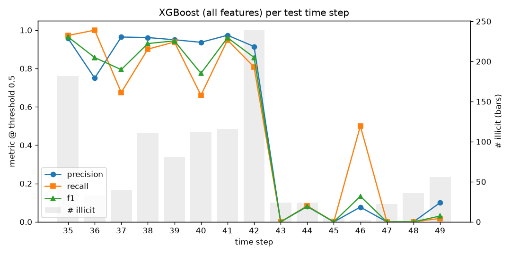

# fraud-graph-bench

Fraud detection benchmarks on the [Elliptic Bitcoin dataset](https://arxiv.org/abs/1908.02591) (203,769 transactions, 4,545 labeled illicit, 42,019 licit), with a strict time-based split: train on time steps 1–34, test on 35–49.

The baseline is XGBoost on the 165 node features. On the test set it reaches F1 0.794 and PR-AUC 0.800 (illicit = positive). Those single numbers hide most of what matters. Findings 1–3 come from `scripts/run_analysis.py`. Finding 4 compares XGBoost with an MLP and the TabICL foundation model. Every number is copied from the files in `results/` or from a script's printed output.

## Findings

### 1. The model fails after step 43, and the aggregate score hides it



| Test steps | Illicit | Caught | False positives | Recall | F1 |
|---|---|---|---|---|---|
| 35–42 | 914 | 790 | 54 | 0.864 | 0.899 |
| 43–49 | 169 | 4 | 68 | 0.024 | 0.033 |

Recall is exactly 0 at steps 43, 45, 47 and 48. The headline F1 of 0.79 comes from steps 35–42. A single aggregate test number hid a near-total failure after step 43.

Weber et al. 2019 (Sec. 4, "The Dark Market Shutdown") report a dark market closing at time step 43 and say this "causes all methods to perform poorly after the shutdown". Even a Random Forest retrained after every test step "is not able to reliably capture new illicit transactions". Our model shows the same thing:

- The median score it gives illicit transactions is 0.9997 in steps 35–42 and 0.0006 in steps 43–49. It treats the later fraud as licit.
- The number of illicit transactions also drops, from 914 in steps 35–42 to 169 in steps 43–49.

One likely explanation is that the model learned the patterns of the actors active before the shutdown, and the illicit activity afterwards looks different. Fraud patterns change over time, which is why performance should be monitored per time period and not only as one test-set number.

### 2. Neighbor features help: 13% fewer alerts at 80% recall

Weber et al. 2019 (Sec. 2.1.2) split the features into 94 local ones (including the time step) and 72 aggregated over each transaction's one-hop neighbors. PyG drops the time step, which leaves 93 local and 72 aggregated (see [Feature groups](#feature-groups)).

| Features | Count | PR-AUC | F1 @ 0.5 | False positives at 80% recall |
|---|---|---|---|---|
| Local only | 93 | 0.785 | 0.739 | 2,226 |
| Local + neighbor aggregates | 165 | 0.800 | 0.794 | 1,945 |

PR-AUC barely moves. Where it matters, the gain is clear: F1 rises from 0.739 to 0.794, and false positives at 80% recall drop from 2,226 to 1,945. That is 12.6% fewer alerts for analysts to review.

These 72 features are hand-made one-hop summaries. They say nothing about what a model that learns across several hops could do.

**Takeaway:** simple neighbor aggregates already cut false positives by 13% at 80% recall. Whether learned multi-hop models do better is the next experiment.

### 3. A threshold chosen without the test set: 36 false positives, not 1,945

The baseline's "1,945 false positives at 80% recall" uses a threshold picked with the test labels. That is leakage, because it can't be done in deployment. Instead:

1. Train on steps 1–29.
2. Pick the threshold that gives 80% recall on steps 30–34 (validation).
3. Retrain on steps 1–34 and apply that threshold to the test set.

| Threshold chosen on | Threshold | Test recall | Test false positives | Illicit caught |
|---|---|---|---|---|
| Validation (steps 30–34) | 0.808 | 0.724 | 36 | 784 / 1,083 |
| Test set (leakage) | 0.006 | 0.801 | 1,945 | 867 / 1,083 |

On validation, threshold 0.808 gave 80.0% recall with 7 false positives. On the test set it gives 72% recall with 36 false positives. The target isn't met because of the same drift: the validation period comes before the shutdown, and 98% of illicit transactions after step 43 score below 0.5.

Reaching 80% recall on the test set requires dropping the threshold to 0.006. That catches 83 more illicit transactions (54 from steps 35–42, 29 from 43–49), but false positives rise from 36 to 1,945.

**The number to report** is the validation-chosen one: 72% recall at 36 false positives. Report it together with the warning from finding 1 that performance collapsed after the shutdown.

### 4. A foundation model with no training on Elliptic matches XGBoost, at a large inference cost

All three models use the same time split (fit on steps 1–34, test on 35–49). Numbers are from `results/xgboost.json`, `results/tabicl.json` and the printed output of `scripts/run_mlp.py`.

| Test set, steps 35–49 | XGBoost | MLP | TabICL |
|---|---|---|---|
| Fitting on Elliptic | 300 trees, fixed settings, not tuned | 20 epochs, one hidden layer of 64 | No weight updates; training rows passed as context |
| PR-AUC | 0.800 | 0.472 | 0.812 |
| ROC-AUC | 0.926 | 0.892 | 0.955 |
| Precision @ 0.5 | 0.867 | 0.516 | 0.922 |
| Recall @ 0.5 | 0.733 | 0.600 | 0.713 |
| F1 @ 0.5 | 0.794 | 0.555 | 0.804 |
| False positives at 80% recall | 1,945 | not computed | 1,567 |
| Illicit caught in steps 43–49 (of 169) | 4 | not computed | 3 |
| Inference time per transaction | 0.59 ms one row at a time; 0.00085 ms batched (CPU) | not measured | 55 ms, batched average (Tesla T4 GPU, chunks of 1,000) |

TabICL is a pretrained tabular foundation model that never trained on Elliptic. It matched or slightly beat XGBoost on ranking and precision: PR-AUC 0.812 vs 0.800, and 19% fewer false positives at 80% recall (1,567 vs 1,945). Its recall at 0.5 is a little lower (0.713 vs 0.733). The plain MLP is far behind both.

TabICL fails after the dark market shutdown just like XGBoost. It caught 3 of 169 illicit transactions in steps 43–49, so finding 1 isn't a quirk of tree models.

Inference costs far more. TabICL averaged 55 ms per transaction on a GPU, against 0.00085 ms for XGBoost scoring a batch on CPU (about 65,000×) and 0.59 ms for XGBoost scoring one row at a time (about 90×). The two models ran on different hardware, so these ratios are rough.

**Caveats:**

- **XGBoost wasn't tuned.** A tuned XGBoost might close the gap.
- **One run, no confidence intervals.** A PR-AUC gap of 0.012 may be within noise. Bootstrapping the test set would answer that, so it's a natural next step.
- **The 80% recall threshold was still chosen on the test set,** for all models (see finding 3).
- **The 55 ms is an average over batches,** not the latency for scoring one transaction. It was measured on a free Colab T4 with `batch_size=1` (ensemble members run one at a time; TabICL's default is 8) and `kv_cache` off. Caching the training context is the next thing to try and could change the latency picture.
- **TabICL couldn't run on the 7 GB CPU machine** used for the other models. Scoring ran out of memory even in chunks with `batch_size=1`, so its numbers come from Colab.

## Setup

```bash
python3 -m venv .venv
source .venv/bin/activate
pip install torch --index-url https://download.pytorch.org/whl/cpu   # CPU build
pip install -r requirements.txt --extra-index-url https://download.pytorch.org/whl/cpu
pip install -e .
```

## Run

```bash
python scripts/run_baseline.py   # downloads data/ on first run, writes results/xgboost.json
python scripts/run_analysis.py   # writes results/analysis.json and results/per_step.png
python scripts/run_mlp.py        # prints MLP test metrics (no results file)
pytest -q                        # split / leakage tests
```

TabICL needs `pip install tabicl` (2.2.0 was used) and, in practice, a GPU:

```bash
DEVICE=cuda BATCH_SIZE=1 CHUNK_SIZE=1000 python scripts/run_tabicl.py   # writes results/tabicl.json
```

Defaults are `DEVICE=cpu`, `BATCH_SIZE=1`, `CHUNK_SIZE=2000`.

## Protocol

- **Split by time step, never randomly**: train on 1–34, test on 35–49. For the threshold analysis: train on 1–29, validate on 30–34.
- Only labeled nodes are used (illicit = 1, licit = 0); unknowns are dropped.
- At load time the code checks that time steps from the raw CSV line up with PyG's node order, and that the split matches PyG's own `train_mask`/`test_mask`.
- **XGBoost**: fixed settings (300 trees, depth 6, learning rate 0.1, seed 42), no tuning. `scale_pos_weight` = licit/illicit count in the training data.
- **Graph information**: the model doesn't use the edge list. It does use graph information indirectly, because 72 of the 165 features are aggregates over one-hop neighbors.

### Feature groups

Weber et al. 2019 ([arXiv:1908.02591](https://arxiv.org/abs/1908.02591), Sec. 2.1.2): "the first 94 features represent local information about the transaction – including the time step", and "the remaining 72 features, called aggregated features, are obtained by aggregating transaction information one-hop backward/forward from the center node". The raw CSV is `[txId, time_step, 165 features]`, and PyG's `x` equals CSV columns 2–166 (checked against the raw file). So in `x`:

- columns 0–92: local (93 features; the paper's 94 minus the time step)
- columns 93–164: aggregated over neighbors (72 features)

These are defined as `LOCAL_COLS` / `AGG_COLS` in `src/fraudbench/data.py`.

## Metrics (illicit = positive)

- Precision, recall, F1 at threshold 0.5
- PR-AUC (average precision), ROC-AUC
- False positives at 80% recall, using the highest threshold with recall ≥ 0.80. The baseline picks this threshold on the test set, so it is optimistic; see finding 3.
- Inference latency in mean ms per transaction, measured both batched (full test set / n) and one row per call

## Layout

```
src/fraudbench/   data.py (loading, split, feature groups), xgb.py, metrics.py
scripts/          run_baseline.py (XGBoost), run_analysis.py (findings 1-3),
                  run_mlp.py (MLP), run_tabicl.py (TabICL)
tests/            test_split.py
results/          JSON outputs and per_step.png
```

## How this was built

I used Claude Code to implement the scripts. I designed the evaluation questions with AI guidance, reviewed every result, and chose what to report.

## Next steps

Some next steps could be to explore training a GNN using the edge list, tuning XGBoost, applying other tabular and relational foundation models, and finding a way to address distribution shift like the time step 43 shutdown.